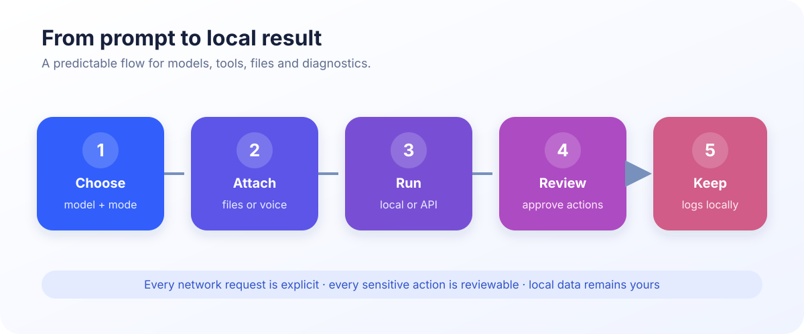
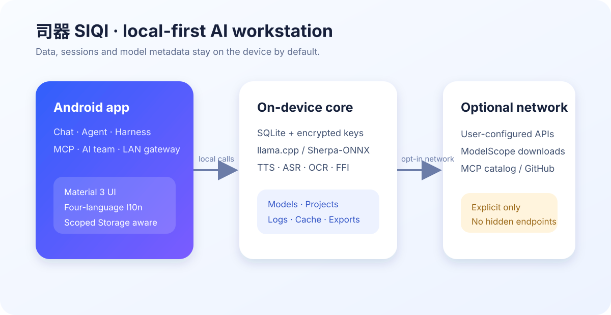

# 司器 SIQI

> Android 端侧优先 AI 工作站 · 本地模型 · Agent · Harness · MCP · 多模态

[](https://github.com/psq0421/SIQI/releases/tag/v1.0.0.Beta.4) [](https://github.com/psq0421/SIQI/releases) [](LICENSE)

<p align="center"></p>
<p align="center"><strong>把模型、工具和一点点折腾精神，装进手机里。</strong><br />没网时不掉链，非要联网也不高冷；能本地跑，就尽量不把数据交给未知远方。</p>

中文 | [English](README_EN.md)

## Beta.4：从能运行，到可追溯

本次 Beta 为 **1.0.0-beta.4 · build 4300**：保留原有标识，重绘界面；前台默认保持亮屏；Agent 从模型请求开始记录完整任务轨迹；基准测试留下可导出的原始 JSONL。端侧优化主线转向 **MiniCPM**。

[下载 Beta.4](https://github.com/psq0421/SIQI/releases/tag/v1.0.0.Beta.4) · [详细双语更新日志](CHANGELOG_BETA4.md) · [研究接口与验收协议](docs/research-beta4.md)。这是预发布版本：专用 35B 路径目前仅支持文本，长上下文和全模态仍未完成验收。

> **以诚为本**：128K 是产品配置上限。大模型的实际驻留上下文仍由设备内存、模型大小和当前压力动态决定；性能记录同时保存 `requestedContext` 与 `effectiveContext`，不把配置值冒充成实际 KV 容量。

## 为什么叫司器呢

“司”代表掌控与调度，“器”代表可使用、可观测的工具。模型不是远程黑盒，而是可以被观察、配置、切换和管理的生产工具。
（别听作者一本正经的胡诌，我总感觉他在谐音某个人的名字......）

## 四层工作机制



| 层级 | 负责什么 | 关键原则 |
| --- | --- | --- |
| 交互层 | 对话、附件、语音、OCR、模型切换 | 能力显式展示，空输入和不支持的模态不会误触发 |
| 编排层 | Chat、Agent、Harness、MCP、AI 团队 | 先计划、再授权；工具调用逐次可审计 |
| 执行层 | llama.cpp CPU / Vulkan、专用 LES 文本运行时、语音与 OCR 原生引擎、Isolate | 后端能力与模型兼容性显式检查，不把检测到芯片等同于已加速 |
| 数据与安全层 | 本地数据库、加密密钥、工作区、日志 | 本地优先、边界清晰、拒绝越界和静默执行 |



## 核心能力

- **Chat**：历史搜索、流式输出、思考强度、远程 API 与端侧模型切换。
- **Agent**：在选定工作区内理解需求、规划、修改、运行和复核；写入前展示动作并支持撤销。
- **任务轨迹**：SQLite v7 保存输入、模型请求、计划、动作顺序、每步结果及终止原因；失败、取消和重启中断可单独导出。
- **Harness**：DeepSeek API 驱动的代码审查、静态检查和测试建议。
- **MCP**：Streamable HTTP、HTTP+SSE；开发者模式下可管理 stdio 工具。
- **AI 团队**：最多 8 个已测试云端模型协作，多轮共享上下文并生成汇总。
- 统一管理对话、TTS、ASR、OCR 模型；卡片显示来源、格式、许可证和实际运行状态。
- GGUF 通过 llama.cpp FFI 在独立工作线程中运行，下载支持断点续传和 SHA-256 校验。
- 图片、PDF、音频、Office 文档和大文本采用路径或流式处理，避免复制整份文件到 UI 内存。
- 番外话：作者写的界面实在烂透了，所以我让他借助CodeX换了层皮，我又偷偷给他代码里加了点注释、修了点bug，他挺高兴的。

## CPU / GPU / NPU 调度

设置 → **CPU 与加速器调度** 可查看每个核心的架构与最高频率，并选择进程亲和性，以下以基准测试平台骁龙8+ Gen1为例：

```text
CPU0–3  Cortex-A510  @ 2.02 GHz
CPU4–6  Cortex-A710  @ 2.75 GHz
CPU7    Cortex-X2    @ 3.19 GHz
```

系统会提示不建议使用 A5xx 垃圾小核运行大模型。Arm v9、Hexagon 和 QNN runtime 分层检测；当前 APK 打包 llama.cpp CPU / Vulkan 与专用 LES 文本运行时，**没有将 GGUF 变成 NPU 模型**。LES 默认使用 CPU；MNN 生产集成和 QNN/HTP 推理仍未完成，不把芯片检测当作加速成果。

## MiniCPM：下载与运行分开验收

模型目录涵盖 MiniCPM3 / 4 / 4.1 / 5、MiniCPM‑V 2.6 / 4.x，以及 MiniCPM‑o；提供 ModelScope 直链、文件大小、许可证和 SHA-256。`-o` 的文本/图像版本不等于音频全双工支持。卡片明确区分可运行与“运行时适配中”。

重点 35B‑A3B 提供 `mix_q3gud_im` 和 `Q4_K_M` 两个产物，权重约 15.50 / 21.17 GB，视觉组件另约 1.12 GB。文件大小不能作为内存需求或已达标的证据。

**Beta.4 安装包已集成 4.7 35B 混合量化的 LES 文本运行时。** 最终 Release 在骁龙 8+ Gen1 / 12GB / Android 17 上完成四轮测试，纯 Decode **3.49–3.90 token/s**（中位数 **3.65**），排除前 8 token 后 **3.53–3.96**；每轮实际输入 51 token、窗口 2K、输出 128 token。这不是长上下文或视觉成绩，权重为 `mix_q3gud_im`，不是 Q4_K_M。四轮采样 RSS/PSS 均低于 decimal 5GB，但不保证瞬时峰值或其他负载严格不超限。历史包五轮 **4.24–4.82** 和 RSS 高水位 **5.002GB** 记录单独保留，不冒充最终包成绩。Q4_K_M 35B 和视觉组件未完成运行验收。详见[优化与八项验收](docs/android-les-optimization.md)。

首次使用自动重排专家并逐字节校验，不修改原始模型；历史首次准备加加载约 71 秒，最终包复用重排缓存后重新加载约 1.72–1.99 秒，非物理冷磁盘测试。需要额外约一份模型的存储空间；设置 → 日志与缓存可单独清理 LES 缓存。默认 CPU4 自适应线程、56 专家窗口，Q4 KV、LRU、路由预取、文件映射和协作等待共同工作；LRU 是尽力保留的映射，不保证 Android 永不回收页面。Adreno 实验路径更慢，不默认启用。保留 **0.0428 token/s** 的早期失败基线与全部超时记录，不隐藏失败。

**真实长文仍未达标**：历史开发包完整处理 4,785 个输入 token、8K 窗口、256 个输出 token 后，56/96 专家窗口纯 Decode 分别为 **2.075 / 2.029 token/s**，prefill 约 **23.43 / 20.89 分钟**；最终包未重测长文。扩大专家缓存不能替代计算、I/O 和持续温控的优化。实验室新增同状态 4/2/6/8 线程回放诊断；非基准配置的 token 序列不同，不宣称品质等价。日志汇总按真实负载和模型冷/热状态分组，不再混算短答与长文。

（停停停，我吐槽两句：这两段我不想写，可惜作者非要主动暴露缺点。本姑娘看他能力也就那样，性格怎么跟Dario Amodei一样怪？）

## 日常体验与日志教程

- 设置 → 界面与外观 → **前台保持亮屏**：默认开启，只在应用前台生效（原神你还没玩过吗）；关闭后遵循系统息屏策略，不申请唤醒锁权限。
- 设置 → **日志与缓存** → **Agent 任务轨迹**：导出最近 100 条轨迹，或最近 100 条失败/取消/中断任务；分享前有隐私提醒。
- Agent 先规划，查看拟执行动作，再授权执行。越界路径和未授权写入会留下失败记录；重启时未完成任务标记为中断，不冒充成功。
- 设置 → **性能实验室**：选择已安装且运行时兼容的模型与 CPU/Vulkan 配置，运行后导出基准 JSONL。记录设备、模型校验、实际上下文、吞吐、RSS/PSS、缺页和温控。

轨迹在写入时尝试遮蔽常见凭据；工具输出有长度上限，写入动作保存大小与校验值，不复制整个代码文件。**自动脱敏不能保证匿名**：输入、路径与工具输出仍需人工审阅，分享渠道由用户选择，没有自动上传。

## 权限、工作区与隐私

- 权限按功能首次使用申请；拒绝不会阻止启动。
- 默认使用应用专属目录，不需要 Root，也不要求用户输入命令。
- API 密钥使用 Android 加密存储；会话、模型记录、MCP、权限审计和工作日志使用本地数据库。
- 工作区、模型路径、导入导出、工作日志和缓存均可在设置中管理。

## 安装与升级

前往 [v1.0.0.Beta.4 Releases](https://github.com/psq0421/SIQI/releases/tag/v1.0.0.Beta.4) 下载：

| 包 | 用途 |
| --- | --- |
| `app-release.apk` | 日常使用，约 40.76 MiB，推荐安装 |
| `app-debug.apk` | 开发调试，约 130.77 MiB |
| `SHA256SUMS.txt` | 两个安装包的 SHA-256 校验清单 |

适用于 Android 10–17、arm64-v8a；35B 优化路径还需 FP16 / DOTPROD / I8MM。覆盖安装不会主动删除会话、配置或已下载模型；旧版本超过 128K 的上下文设置会自动迁移到 128K。两个包仍使用既有本地 Android Debug 证书，Release 表示优化构建，**不是生产密钥签名**。签名不一致时先导出数据，不要直接卸载，喂！（他干过这事，给他弄没脾气了）

## 快速上手

1. 首次启动设置昵称、主题和工作区。
2. 在实验室下载或导入模型，查看许可证、来源和校验状态。
3. 远程 API 必须先完成连接测试；未测试配置不能发送对话。
4. 进入 Agent 前确认工作区和拟执行动作。
5. Harness 插件只导入和管理，不会静默执行。
6. 长任务可查看工作日志、内存压力、缓存和当前推理后端。
7. 作者很懒很懒很懒，非要让本姑娘替他写，如果你能看到这行字，那他一定是对我太放心了，麻烦提issue的时候cue一下作者。

## Beta.3 长输出问题的处理边界

- 修复一个明确触发条件：Android 温控 `SEVERE` 表示降频，不再把它当作必须停止推理；仍在 `CRITICAL` 或持续内核低内存时安全取消。
- 流中断或手动取消会保留已有回复；无输出超时返回明确错误并记录原因，不再无声吞掉内容。
- 尚不能宣称 OSS‑20B 所有长对话停顿已根治；原生解码死锁、LMK 和长上下文需要独立长时回归。没有实现断点续生成。

反馈时请提供设备型号、模型量化、上下文、GPU 设置和脱敏工作日志摘要。

## 开发构建

```bash
flutter pub get
flutter gen-l10n
flutter analyze --no-pub
flutter test --no-pub --reporter expanded
flutter build apk --debug --no-pub
flutter build apk --release --no-pub
```

上述为常规构建。复现本次带 LES 的 APK 还需要准备固定上游源码、应用补丁并传入 `SIQI_LES_SOURCE` 和 `--dart-define=SIQI_LES_RUNTIME=true`，详见[原生构建步骤](docs/android-les-optimization.md#reproduction--开发者复现)。只开启 Dart 开关而不打包原生库不可用。

## Beta.4 十项需求验收（2026-10-14）

交付功能与尚未验收的研究目标分开列示：

| 需求 | 状态 |
| --- | --- |
| MiniCPM-V 4.7 35B | 部分完成：发布包的混合量化 LES 文本路径四轮短输入超过 3 token/s；Q4_K_M 和视觉未验收。 |
| 64K / 128K 上下文 | 部分完成：新安装默认配置 64K，界面提供 128K；实际窗口可降低。 |
| 多模态文件生成 | 部分完成：附件、文本 / Office / PDF 提取和工作区写入。 |
| 模型兼容构件 | 部分完成：可下载已核验 ModelScope 产物；缺少兼容运行时的构件仍阻止执行。 |
| CPU / GPU / Hexagon | 部分完成：核心亲和性、Vulkan 配置、压力 / ZRAM 观测与芯片检测；未集成 QNN / HTP delegate。 |
| MNN | 未完成Runtime，后端枚举不等于已集成；当前使用 llamadart / llama.cpp 与专用 LES。 |
| 默认 System Prompt | 已完成：引导保存身份、安全、工作区、隐私和验证规则。 |
| 历史末尾优先 | 已完成：打开历史定位到最新消息。 |
| 内置终端 | 已完成：设置 → Shell → 开发者终端，保留危险命令确认。 |
| 跨后端 Harness | 部分完成：API 有限适配和本地任务链路存在。 |

安装包校验、签名与真机证据见[验证记录](docs/verification-beta4.md)，下载资产见 [Beta.4 Release](https://github.com/psq0421/SIQI/releases/tag/v1.0.0.Beta.4)。

项目使用 Flutter stable、Riverpod、SQLite、llama.cpp FFI；原生运行时和模型文件遵循各自许可证。提交 Issue 前请隐藏 API Key、个人文件内容和完整会话文本。

研究入口和自动测试不再只停留于计划：源码见 `agent_service.dart`、`local_database.dart`、`performance_lab_page.dart`；汇总工具为 `tools/research/summarize_runs.dart`，CI 定义位于 `.github/workflows/quality.yml`。Git 保留已有真实历史。

## 许可证与反馈

司器源码采用 MIT License。模型、MCP 服务、Harness 运行包和其他第三方组件不自动继承本项目许可证，请遵循对应项目条款。

- Issues：<https://github.com/psq0421/SIQI/issues>
- Discussions：<https://github.com/psq0421/SIQI/discussions>
- 项目主页：<https://github.com/psq0421/SIQI>
